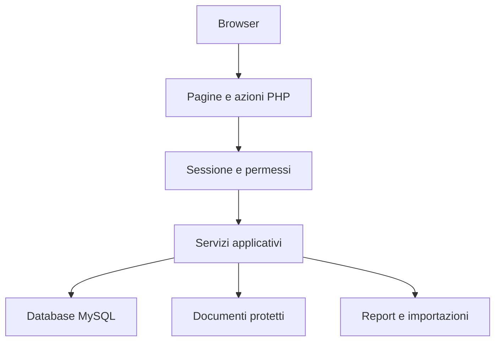
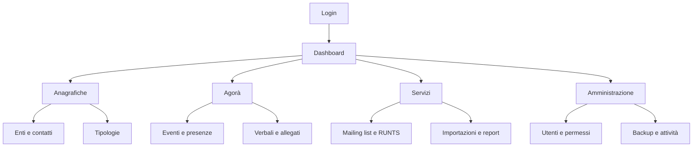
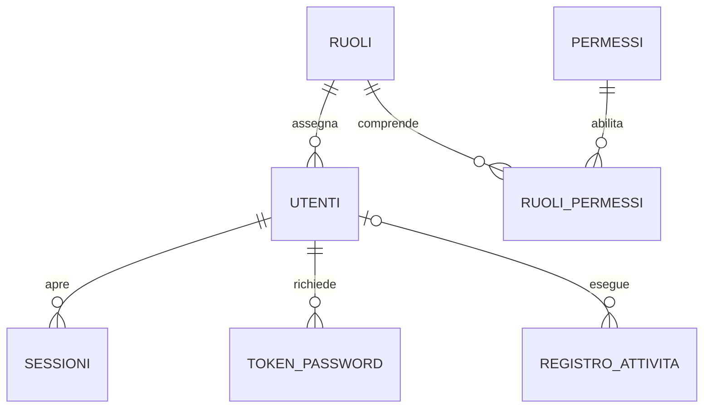
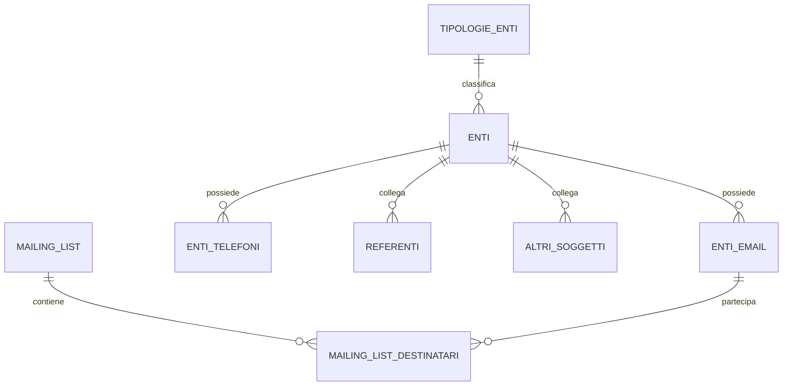
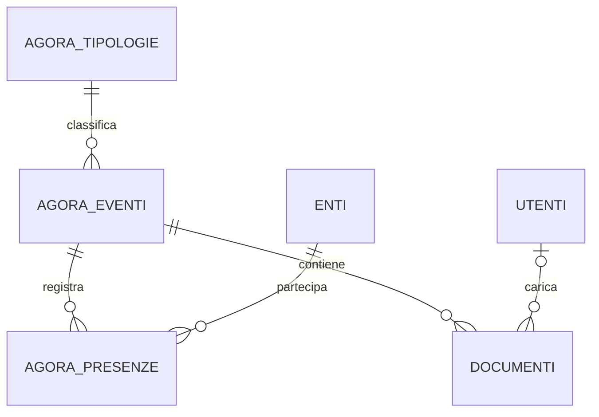

# Trasformazione del Gestionale Enti in PHP

Data: 13 novembre 2026  
Versione del documento: 1.3  
Stato: progetto di riferimento; implementazione non ancora realizzata.

## 1. Obiettivo e decisioni concordate

Riscrivere da zero l'applicazione Windows in PHP e MySQL per un sito Altervista, recuperando le funzionalità gestionali, i dati e i documenti dell'applicazione esistente.

- Tutta l'applicazione sarà riscritta da zero in PHP, comprese schermate, moduli, navigazione, controlli e procedure. Non saranno riutilizzate o semplicemente rinominate le vecchie pagine HTML e non saranno presenti schermate applicative autonome `.html`. L'applicazione esistente sarà solo il riferimento funzionale e la fonte dei dati. PHP genererà il markup necessario alla visualizzazione nel browser: questo è tecnicamente inevitabile in un sito web e non costituisce riutilizzo delle pagine originali. Gli eventuali CSS e JavaScript di supporto saranno anch'essi realizzati per il nuovo progetto; la logica applicativa, i permessi e l'accesso ai dati resteranno in PHP.
- La gestione utenti sarà completamente nuova.
- Sono previste quattro tipologie di utenti: amministratore e utente inizialmente attivi; altre due tipologie da definire successivamente.
- La prima fase di sviluppo riguarda utenti, autenticazione, autorizzazioni e protezione di pagine, operazioni e documenti.
- Sviluppo e collaudo avverranno su un sito di prova, prima del trasferimento sul sito definitivo.
- Durante lo sviluppo il programma Windows continuerà a essere utilizzato e il database continuerà a cambiare.
- La migrazione dei dati dovrà pertanto essere ripetibile e usare l'ultima copia disponibile al passaggio definitivo. È obbligatoria una procedura di lettura diretta del file SQLite .db e conversione nello schema corrente del sito, come specificato nella sezione 14.
- Il nuovo sistema utenti non dovrà essere sovrascritto dalle importazioni del database Windows.
- A ogni modifica strutturale del database deve corrispondere un aggiornamento contestuale della procedura di acquisizione dal file `.db`, della mappatura e dei controlli. Una modifica strutturale non è completa né rilasciabile senza questo aggiornamento e la relativa prova.

Non sono ancora stati definiti indirizzi dei siti, cartella di installazione, credenziali, nomi delle due tipologie future e permessi dettagliati del ruolo utente. Questo documento non contiene credenziali.

## 2. Applicazione di partenza e limiti dell'analisi

Riferimento: pacchetto `windows.zip` analizzato nella conversazione.

Il pacchetto contiene un eseguibile Windows con server Node.js/Express incorporato, pagine HTML e JavaScript, database SQLite, archivio PDF, copie di backup e file Excel. I metadati del pacchetto riportano la versione 2.4.0; la configurazione dell'interfaccia riporta 2.0.0.

Il server principale è incorporato come bytecode: non è stato recuperato come sorgente completo leggibile. Le pagine e la struttura del database permettono di ricostruire molte funzioni, ma non dimostrano tutte le regole applicative. Il programma Windows non è stato eseguito nell'ambiente di analisi.

### Dati osservati nella copia analizzata

| Contenuto | Quantità |
| --- | ---: |
| Associazioni | 125 |
| Referenti | 40 |
| Altri soggetti | 61 |
| Email degli enti | 138 |
| Telefoni degli enti | 18 |
| Record RUNTS | 138.761 |
| Mailing list | 2 |
| Collegamenti destinatari alle liste | 16 |
| Eventi Agorà | 23 |
| Presenze | 218 |
| Utenti esistenti | 3 |

Queste quantità descrivono la copia analizzata, non il database operativo aggiornato. Il controllo SQLite di integrità ha restituito `ok`; il controllo dei vincoli esterni dichiarati non ha rilevato violazioni. Questi risultati non costituiscono un collaudo delle funzioni del programma.

### Aspetti osservati da non trasferire senza revisione

- Lo script di sblocco cerca `gestionale.db.LOCKED`, mentre il programma contiene il riferimento `database.db.LOCKED`.
- Il controllo delle pagine nel JavaScript usa `sessionStorage`; nel nuovo sito l'autorizzazione dovrà essere verificata dal server per ogni richiesta.
- Alcune pagine inseriscono dati dinamici con `innerHTML`: nella riscrittura occorrerà codificare l'output e prevenire XSS.
- Secondo le istruzioni esistenti, il backup automatico del database non include automaticamente l'archivio PDF.
- Alcuni nomi di file mostrano possibili problemi di codifica dei caratteri; i collegamenti andranno verificati prima di rinominare file.

## 3. Architettura proposta

Il sito sarà implementato da zero in PHP per schermate e operazioni, con PDO per MySQL e una base comune per configurazione, sessioni, autorizzazioni, validazione e layout. Non si convertiranno le vecchie schermate cambiandone soltanto l'estensione: struttura e codice delle pagine saranno nuovi.

### Organizzazione delle cartelle

| Percorso | Contenuto | Regola |
| --- | --- | --- |
| `/` | Schermate principali PHP | Accesso secondo sessione e permessi |
| `/admin/` | Utenti, ruoli, permessi, manutenzione | Accesso amministrativo autorizzato |
| `/azioni/` | Salvataggi, eliminazioni, importazioni | Sessione, permessi e protezione CSRF |
| `/assets/` | CSS, JavaScript e immagini | Nessun dato riservato |
| `/app/` | Servizi, autenticazione, connessione, layout | Accesso web diretto vietato |
| `/config/` | Configurazione dell'ambiente | Accesso web diretto vietato |
| `/storage/documenti/` | Verbali e allegati | Accesso web diretto vietato |
| `/storage/backup/` | Backup | Accesso web diretto vietato |
| `/storage/log/` | Log | Accesso web diretto vietato |
| `/database/` | Schema e migrazioni SQL | Accesso web diretto vietato |

Quando consentito dall'hosting, file riservati e configurazione saranno collocati fuori dalla cartella pubblica. In alternativa si applicheranno regole del server, da provare con richieste dirette: un semplice file `index.php` vuoto non protegge una cartella.

Indirizzo base, eventuale sottocartella, connessione DB, percorsi, ambiente e impostazioni email saranno centralizzati. Nessun collegamento dovrà dipendere da un dominio fisso del sito di prova.

## 4. Utenti, ruoli e sicurezza: prima fase

### Ruoli

| Ruolo | Stato iniziale | Regola |
| --- | --- | --- |
| Amministratore | Attivo | Gestione completa e configurazione delle autorizzazioni |
| Utente | Attivo | Solo permessi esplicitamente assegnati |
| Terza tipologia | Da definire | Non assegnabile finché non configurata |
| Quarta tipologia | Da definire | Non assegnabile finché non configurata |

Proposta iniziale: un ruolo per utente, molti permessi per ruolo. I due ruoli futuri non richiedono condizioni speciali nel codice: si aggiungeranno nella configurazione. Non sarà presente registrazione pubblica; gli account saranno creati dall'amministratore.

### Funzioni richieste

- Login con email e password; password memorizzate tramite `password_hash` e verificate con `password_verify`.
- Creazione sicura del primo amministratore con procedura iniziale disabilitata dopo l'uso e senza password predefinita pubblica.
- Attivazione, disattivazione, cambio ruolo e reimpostazione password.
- Recupero password con token casuali, memorizzati come hash, a scadenza e monouso; invio email da configurare e collaudare sul sito.
- Cookie di sessione protetti: HttpOnly, Secure su HTTPS e SameSite adeguato.
- Rigenerazione dell'identificativo di sessione dopo il login; scadenza dopo 30 minuti di inattività e durata massima configurabile, verificate lato server.
- Revoca delle sessioni in caso di disattivazione, cambio password o variazione dei privilegi.
- Limitazione dei tentativi di accesso, errori di login generici e tracciamento senza registrare password o token.
- Controllo lato server per ogni pagina, azione, esportazione e documento; accesso negato in assenza di un permesso esplicito.
- Token CSRF per le operazioni che modificano lo stato; nessuna cancellazione tramite semplici link GET.
- Query preparate, validazione dei dati, codifica dell'output e controllo dei caricamenti.
- Impedire la disattivazione o rimozione dell'ultimo amministratore attivo.

La protezione degli accessi e la cifratura saranno entrambe parte del progetto. Il modello prevede un archivio condiviso tra utenti autorizzati, con cifratura lato server dei campi riservati e dei documenti, secondo la sezione 13. Non è prevista cifratura end-to-end: il server potrà decifrare per fornire le funzioni autorizzate.

### Esempi di permessi

`enti.visualizza`, `enti.crea`, `enti.modifica`, `enti.elimina`, `agora.visualizza`, `agora.modifica`, `documenti.scarica`, `documenti.carica`, `mailinglist.gestisci`, `runts.importa`, `report.esporta`, `utenti.gestisci`, `permessi.gestisci`, `backup.gestisci`.

Nascondere una voce di menu non sostituisce il controllo dell'operazione lato PHP.

## 5. Pagine del sito

| Area | Pagine proposte | Funzioni |
| --- | --- | --- |
| Accesso | `login.php`, `logout.php`, `password-dimenticata.php`, `reimposta-password.php` | Accesso e recupero |
| Profilo | `profilo.php`, `cambia-password.php` | Gestione del proprio account |
| Dashboard | `index.php` | Collegamenti e riepiloghi autorizzati |
| Enti | `enti.php`, `ente.php` | Elenco, ricerca e scheda con email e telefoni |
| Persone | `referenti.php`, `altri-soggetti.php` | Persone collegate agli enti |
| Tipologie | `tipologie-enti.php` | Classificazioni |
| Agorà | `agora.php`, `agora-evento.php`, `agora-tipologie.php` | Registro e schede eventi |
| Presenze | `agora-presenze.php` | Partecipanti e rappresentanti |
| Documenti | `documenti.php`, `documento.php` | Archivio e download controllato |
| Mailing list | `mailing-list.php`, `mailing-lista.php` | Liste e destinatari |
| RUNTS | `runts.php`, `runts-importa.php`, `runts-confronta.php` | Ricerca, importazione e confronto |
| Report | `report.php`, `esporta-excel.php`, `esporta-pdf.php` | Esportazioni protette |
| Utenti | `admin/utenti.php`, `admin/utente.php` | Gestione account |
| Permessi | `admin/ruoli.php`, `admin/permessi.php` | Tipologie e autorizzazioni |
| Manutenzione | `admin/backup.php`, `admin/attivita.php`, `admin/impostazioni.php` | Backup, log e parametri |

I nomi sono una proposta progettuale. Il logout dovrà essere attivato con richiesta POST protetta. Le procedure di modifica useranno POST e il ritorno alla pagina dopo il salvataggio eviterà invii duplicati.

## 6. Database MySQL proposto

Schema logico da tradurre in migrazioni SQL versionate. I nomi dei campi gestionali nelle tabelle seguenti sono logici: per quelli riservati la rappresentazione fisica cifrata e gli indici di ricerca sono specificati nella sezione 13.7. Usare InnoDB, codifica `utf8mb4`, chiavi esterne e indici sulle relazioni e sui campi di ricerca. Le date senza orario saranno DATE; i timestamp avranno una convenzione coerente, con visualizzazione Europe/Rome.

### 6.1 Accesso e autorizzazioni

| Tabella | Campi principali e vincoli |
| --- | --- |
| `utenti` | `id`, `ruolo_id` FK, `nome_cifrato`, `email_cifrata`, `email_lookup` univoco, `password_hash`, `attivo`, `cambio_password_obbligatorio`, `creato_il`, `ultimo_accesso` |
| `ruoli` | `id`, `codice` univoco, `nome`, `descrizione`, `attivo` |
| `permessi` | `id`, `codice` univoco, `area`, `descrizione` |
| `ruoli_permessi` | PK composta `ruolo_id`, `permesso_id`, entrambe FK |
| `sessioni` | Identificativo protetto, `utente_id` FK, creazione, ultima attività, scadenza, revoca |
| `token_password` | `id`, `utente_id` FK, `token_hash`, finalità, scadenza, utilizzo |
| `tentativi_accesso` | `id`, identificativo tentato, IP, data, esito |
| `registro_attivita` | `id`, `utente_id` opzionale, azione, entità, ID record, data, esito |

### 6.2 Enti, contatti e mailing list

| Tabella | Campi principali e vincoli |
| --- | --- |
| `tipologie_enti` | `id`, `descrizione` univoca |
| `enti` | `id`, `tipologia_id` FK, `denominazione`, `codice_fiscale`, `tavolo`, `direttivo_delegazione`, campo legacy `COLONNA3` da chiarire |
| `enti_email` | `id`, `ente_id` FK, `indirizzo`, `pec`, `predefinito`; univocità ente e indirizzo |
| `enti_telefoni` | `id`, `ente_id` FK, `telefono`, `predefinito`; univocità ente e numero |
| `referenti` | `id`, `ente_id` FK, `nome`, `email` |
| `altri_soggetti` | `id`, `ente_id` FK, `nome`, `email` |
| `mailing_list` | `id`, `descrizione` univoca, `note` |
| `mailing_list_destinatari` | `id`, `mailing_list_id` FK, `ente_email_id` FK, `tipo_invio`; coppia lista e email univoca |

Definire e verificare la regola per un solo contatto predefinito per ente. La gestione delle liste non implica automaticamente un servizio di spedizione email: il comportamento di preparazione/invio del programma originale dovrà essere inventariato.

### 6.3 Agorà e documenti

| Tabella | Campi principali e vincoli |
| --- | --- |
| `agora_tipologie` | `id`, `descrizione` |
| `agora_eventi` | `id`, `tipologia_id` FK, `data`, `titolo`, `ordine_del_giorno` |
| `agora_presenze` | `id`, `evento_id` FK, `ente_id` FK, `rappresentante`; prevenzione dei duplicati |
| `documenti` | `id`, `evento_id` FK, categoria verbale/allegato, nome originale, nome interno, MIME, dimensione, hash, autore opzionale e data |

Ogni evento potrà avere più documenti. I file saranno identificati tramite ID, non attraverso percorsi forniti liberamente dal browser. Cancellazioni di eventi, presenze e allegati richiederanno regole esplicite, conferma e registrazione dell'esito.

### 6.4 Fonti esterne e manutenzione

| Tabella | Contenuto |
| --- | --- |
| `runts_enti` | Codice fiscale, denominazione, nome, cognome, provincia, eventuale `ente_id` FK |
| `cesvot_email` | Denominazione e indirizzi importati |
| `cesvot_telefoni` | Denominazione e telefoni importati |
| `importazioni` | Origine, file, autore, data, stato e conteggi |
| `importazioni_righe` | Area temporanea con dati, errori ed esito per riga |
| `impostazioni` | Parametri applicativi e report; segreti esclusi dai valori leggibili dagli utenti |
| `backup` | Tipo, data, posizione interna, esito e verifiche |
| `migrazioni_legacy` | Esecuzione, origine, versione del convertitore, conteggi ed errori |

Se gli ID originali non vengono conservati direttamente, aggiungere una tabella di corrispondenza con sistema di origine, tabella, ID originale e nuovo ID, con vincolo univoco sull'origine.

### 6.5 Mappatura iniziale dalle tabelle SQLite

| Origine | Destinazione / trattamento |
| --- | --- |
| `Tipologia` | `tipologie_enti` |
| `Associazioni` | `enti` |
| `Mail` | `enti_email` |
| `Telefono` | `enti_telefoni` |
| `Referenti` | `referenti` |
| `AltriSoggetti` | `altri_soggetti` |
| `MailList` | `mailing_list` |
| `ListaMail` | `mailing_list_destinatari` |
| `AgoraTipoEvento` | `agora_tipologie` |
| `Agora` | `agora_eventi` e `documenti` |
| `AgoraPresenti` | `agora_presenze` |
| `Runts` | `runts_enti` |
| `CesvotMail` | `cesvot_email` |
| `CesvotTelefono` | `cesvot_telefoni` |
| `Agora_old` | Conservare e confrontare prima di archiviare o integrare |
| `Temporanea` | Valutare se area di lavoro da sostituire con importazioni temporanee |
| `Utenti` | Non sovrascrivere gli utenti del nuovo sito; eventuale acquisizione nominativi separata |
| `Report` | Chiarire significato e uso della password presente; non trasferirla automaticamente come credenziale |
| `sqlite_sequence` | Non migrare come tabella applicativa; riallineare gli AUTO_INCREMENT MySQL |

## 7. Funzioni da recuperare e verificare

| Modulo | Comportamenti da riprodurre |
| --- | --- |
| Anagrafiche | Ricerca, filtri, scheda, inserimento, modifica, eliminazione controllata |
| Contatti | Email, PEC, telefoni, contatto predefinito, referenti e altri soggetti |
| Mailing list | Creazione liste, ricerca destinatari, aggiunta, rimozione e tipo di invio |
| Agorà | Tipologie, registro, date, titolo, ordine del giorno, modifica e consultazione |
| Presenze | Ente, rappresentante, aggiunta, rimozione e prevenzione dei duplicati |
| Documenti | Caricamento, apertura, download, collegamento evento e rimozione autorizzata |
| RUNTS | Importazione, ricerca, confronto e aggiornamento controllato |
| Excel | Importazioni previste e report con colonne concordate |
| PDF e ZIP | Riproduzione di contenuti, selezioni e allegati previsti |
| Backup | Database e documenti, conservazione e ripristino verificato |

Per ogni funzione compilare una scheda con: schermata originale, input, controlli, risultato atteso, messaggi, permessi, dati di esempio ed esito del confronto. La parità funzionale non potrà essere dichiarata prima del completamento di questo inventario e dei test.

## 8. Sito di prova e aggiornamenti del database

Il sito di prova avrà configurazione, database, sessioni e archivio documentale separati dalla produzione. Le prove su copie reali saranno accessibili esclusivamente agli autorizzati. Eventuali email di test dovranno essere indirizzate a destinatari di collaudo.

### Reimportazione durante lo sviluppo

1. Acquisire una copia coerente del database Windows, preferibilmente dopo chiusura regolare dell'applicazione, insieme ai PDF aggiornati.
2. Registrare data, hash, conteggi e origine della copia.
3. Importare in tabelle temporanee e validare prima di sostituire i dati di prova.
4. Verificare date, codifica, unicità, relazioni, presenze e riferimenti ai file.
5. Pubblicare l'importazione solo se i controlli passano; mantenere la precedente copia ripristinabile.
6. Non importare sopra utenti, ruoli, permessi, sessioni e impostazioni del nuovo sito.

Per la prima versione si propone una sostituzione controllata dei soli dati gestionali di prova, non una sincronizzazione bidirezionale. I record creati per test non saranno riportati nella produzione. Anche gli ID e le relazioni dei documenti dovranno essere riallineati nello stesso passaggio.

## 9. Passaggio al sito definitivo

1. Completare il collaudo e registrare la versione del codice approvata.
2. Creare backup coerenti di database e documenti e verificare la procedura di ripristino.
3. Sospendere gli aggiornamenti nel programma Windows.
4. Acquisire l'ultimo database e l'archivio documentale completo.
5. Eseguire la conversione in un'area di preparazione e confrontare conteggi e collegamenti.
6. Trasferire codice e documenti; impostare configurazione, HTTPS, database, email e percorsi del sito definitivo.
7. Importare i dati approvati senza sovrascrivere la nuova gestione utenti.
8. Provare login, ruoli, consultazione, salvataggio, download ed esportazioni sul sito definitivo.
9. Aprire il sito agli utenti e mantenere il vecchio programma in sola consultazione.

Se il passaggio fallisce prima dell'apertura operativa, ripristinare la situazione precedente e riaprire il programma Windows. Se sono già stati inseriti dati sul nuovo sito, un ritorno a Windows richiede prima l'esportazione e la riconciliazione delle nuove modifiche: non basta ripristinare una vecchia copia.

## 10. Fasi di realizzazione e risultati attesi

| Fase | Lavoro | Risultato verificabile |
| --- | --- | --- |
| 0 | Inventario funzioni e verifica hosting | Elenco funzioni e requisiti dell'ambiente |
| 1 | Utenti, ruoli, permessi e protezioni comuni | Login, account amministratore e accessi autorizzati/negati verificati |
| 2 | Layout PHP, menu e configurazione portabile | Navigazione in root e sottocartella |
| 3 | Schema dati e convertitore SQLite/MySQL | Migrazione ripetibile con rapporto degli esiti |
| 4 | Enti, persone e contatti | Gestione completa e vincoli verificati |
| 5 | Agorà, presenze e documenti | Registro e archivio protetto |
| 6 | Mailing list, RUNTS e importazioni | Anteprima, validazione e acquisizione controllata |
| 7 | Report, esportazioni e backup | Confronto degli output e prova di ripristino |
| 8 | Collaudo e migrazione definitiva | Apertura operativa con dati aggiornati |

Ogni consegna comprenderà codice, migrazioni SQL, configurazione di esempio priva di segreti, istruzioni di installazione, test svolti e limitazioni note. Questo documento costituisce il riferimento iniziale, non una consegna dell'applicazione funzionante.

## 11. Criteri di accettazione

- [ ] Schermate e procedure riscritte integralmente in PHP, senza pagine applicative autonome `.html` e senza semplice rinomina o riutilizzo delle schermate originali.
- [ ] Ogni modifica strutturale del database include l'aggiornamento della procedura di acquisizione, della versione compatibile e dei controlli, con importazione di prova superata prima del rilascio.

- [ ] Un visitatore non autenticato non accede a pagine, azioni, report o documenti riservati.
- [ ] Un utente senza permesso riceve un diniego anche usando direttamente l'URL o inviando la richiesta manualmente.
- [ ] La disattivazione o variazione dei privilegi ha effetto anche sulle sessioni già aperte.
- [ ] Recupero password e token scaduti/usati sono gestiti correttamente.
- [ ] Password, segreti e token non sono presenti nei log o nelle pagine.
- [ ] Documenti, configurazione e backup non sono scaricabili direttamente.
- [ ] Operazioni di modifica protette contro CSRF, query non concatenate e output correttamente codificato.
- [ ] File caricati validati per formato, dimensione e destinazione; caricamenti di codice eseguibile rifiutati.
- [ ] Migrazione ripetuta senza duplicazioni e senza perdita dei collegamenti.
- [ ] Conteggi concordi con la fonte o differenze motivate nel rapporto di migrazione.
- [ ] PDF referenziati verificati; mancanti, duplicati e file non collegati elencati per revisione.
- [ ] Report e importazioni confrontati con esempi del programma Windows.
- [ ] Backup completo ripristinato con successo in ambiente di prova.
- [ ] Interfaccia verificata su PC, tablet e telefono.
- [ ] Spostamento dal sito di prova al definitivo eseguito variando configurazione e dati, senza correggere URL nel codice.

## 12. Informazioni da raccogliere prima dell'installazione

- Indirizzo e cartella del sito di prova e del sito definitivo.
- Versione PHP e MySQL/MariaDB effettive; disponibilità PDO MySQL, mbstring, fileinfo, ZipArchive e librerie necessarie ai report.
- Limiti di upload, memoria e durata delle richieste; importazione RUNTS da progettare a blocchi se necessario.
- Regole disponibili per proteggere cartelle e configurazione; funzionamento HTTPS e sessioni.
- Configurazione email per attivazione e recupero password, con prova di consegna.
- Permessi iniziali esatti del ruolo utente; nomi e funzioni dei due ruoli futuri.
- Sorgenti originali se disponibili, oppure accesso dimostrativo al programma ed esempi di importazioni/report.
- Significato del campo `COLONNA3`, trattamento di `Agora_old`, `Temporanea` e impostazioni `Report`.
- Durata di conservazione di backup, log e importazioni temporanee.

Verificare inoltre OpenSSL con AES-256-GCM, libsodium e disponibilità di Argon2id per le password; scegliere i parametri dopo misurazione dei limiti dell’hosting.

La compatibilità specifica dell'hosting e delle librerie dovrà essere verificata durante l'implementazione: non è stata effettuata una prova live su Altervista per questo progetto.

## 13. Protezioni adattate al Gestionale Enti

Questa sezione integra il progetto con le protezioni richieste sulla base della verifica di `diesse63/Famiglia` fornita dall'utente. Le misure qui descritte sono requisiti della futura applicazione, non protezioni già implementate.

### 13.1 Riferimento verificato e limiti

È stato consultato in sola lettura il file [data-key.php di Famiglia](https://github.com/diesse63/Famiglia/blob/main/data-key.php), blob GitHub `5792fdbcb80863a89708b93f2e8df4c1a7cfcaea`, il 13 novembre 2026. Il file usa Argon2id per derivare una chiave dalla password, libsodium secretbox per avvolgere la chiave dati e una copia recuperabile mediante una chiave derivata da `EMAIL_CIPHER_KEY`. Il riferimento al blob identifica il file letto, non un commit completo del repository.

La restante descrizione di Famiglia (AES-GCM delle email e dei PDF, token Drive, sessioni e controlli per utente) è il riepilogo fornito dall'utente e non costituisce un nuovo audit completo svolto per questo documento. Non si assume che il codice pubblicato su Altervista coincida con il repository. Il repository Famiglia non è stato modificato.

Le funzioni finanziarie, bollette e Drive non fanno parte automaticamente del Gestionale Enti: si recuperano i principi di protezione, non i relativi moduli.

### 13.2 Modello di accesso e limiti della cifratura

Nel Gestionale Enti i dati sono condivisi secondo ruolo e permessi, anziché appartenere automaticamente all'utente che li ha inseriti. Il campo `creato_da` è informativo e non è, da solo, una regola di autorizzazione. Non copiare quindi indiscriminatamente i filtri `user_id` dell'applicazione Famiglia.

Ogni richiesta dovrà verificare account attivo, sessione, permesso per l'operazione e ambito del record. Finché non saranno definite limitazioni aggiuntive, l'ambito è l'archivio condiviso. Se i ruoli futuri avranno accesso solo a determinati enti o eventi, introdurre assegnazioni esplicite e applicarle anche a ricerca, conteggi, allegati ed esportazioni.

**Dichiarazione corretta da usare nelle guide:** «I dati riservati e i documenti sono cifrati a riposo e accessibili attraverso il sito secondo i permessi assegnati. Il server dispone delle chiavi necessarie a elaborarli. La cifratura non impedisce a chi controlla il server e le chiavi di decifrarli.»

La protezione mira a ridurre i danni di una copia sottratta del solo database o archivio. Non protegge automaticamente da compromissione dell'applicazione in esecuzione, furto congiunto dei dati e delle chiavi o esportazioni già scaricate. Nessuna promessa di leggibilità esclusiva da parte del proprietario o di inviolabilità.

### 13.3 Classificazione e protezione dei dati

| Dato | Protezione di progetto | Ricerca e uso |
| --- | --- | --- |
| Password | Hash tramite API PHP; preferenza Argon2id se supportato e sostenibile, altrimenti algoritmo PHP supportato con parametri collaudati; mai cifratura reversibile | Verifica password e aggiornamento hash quando necessario |
| Email e nome degli account | Cifratura autenticata; indice HMAC per l'email | Login e unicità mediante confronto esatto normalizzato |
| Email, PEC, telefoni, nomi e contatti delle persone | Cifratura autenticata dei campi | Indici esatti dove necessari; decifratura solo per consultazioni autorizzate |
| Rappresentanti, note riservate, titolo e ordine del giorno degli eventi | Cifratura autenticata | Ricerca testuale da progettare senza copie nascoste in chiaro |
| Denominazioni e codici fiscali di enti, RUNTS e CESVOT | Proposta: mantenere in chiaro i dati di fonte pubblica necessari al confronto; classificare separatamente persone fisiche e informazioni riservate | Decisione da confermare prima della migrazione; la presenza in un registro pubblico non rende pubblico l'intero archivio locale |
| ID, chiavi esterne, tipologie, date evento, flag e associazioni di presenza | In chiaro per relazioni e filtri, con controllo applicativo | Rivelano struttura e collegamenti anche in un dump: limite da documentare |
| PDF, verbali e allegati | File cifrati con autenticazione e accesso PHP controllato | Decifratura solo per download/anteprima autorizzati |
| Nome originale dei file e descrizioni riservate | Metadati cifrati; nome fisico casuale | Il percorso interno non contiene nomi personali |
| Sessioni e token di recupero | Token casuali; nel DB hash degli identificativi verificabili; protezione dei dati di sessione | Nessuna chiave dati nella sessione persistita o nel browser |
| Credenziali email ed eventuali token esterni | Configurazione riservata; cifratura autenticata quando memorizzati nel DB | Nessuna esposizione in pagine, log o repository |
| Backup | Archivio completo cifrato e autenticato | Copia delle chiavi recuperabile separatamente |
| PDF/Excel/ZIP esportati | Richiesta autorizzata, download protetto e tracciato | Un file scaricato in chiaro esce dalla protezione del sito; comunicarlo all'utente |

La matrice distingue volutamente dati cifrati e metadati in chiaro. Prima della pubblicazione va approvato l'elenco fisico dei campi protetti; nessuna nuova colonna contenente dati riservati potrà essere introdotta senza classificarla.

### 13.4 Cifratura e gestione delle chiavi

- Usare un servizio centralizzato con formati versionati. Proposta principale: AES-256-GCM tramite OpenSSL per campi e file di dimensione contenuta, con nonce casuale da 12 byte e tag da 16 byte. Il nonce non deve mai ripetersi con la stessa chiave; nessun nonce statico o derivato dall'ID del record.
- Per file grandi, se i limiti PHP non consentono elaborazione in memoria, usare il formato a flusso autenticato di libsodium secretstream; collaudare compatibilità, errori e consumo di risorse. Evitare suddivisioni artigianali prive di autenticazione.
- Legare tramite dati autenticati aggiuntivi il contenuto a tabella/campo/record o al documento e alla versione del formato, per impedire sostituzioni tra contesti.
- Rifiutare dati con tag non valido, chiave mancante, versione sconosciuta o formato corrotto. Nessun ripiego silenzioso su testo in chiaro.
- Generare chiavi casuali; separare chiave principale di avvolgimento, chiavi dei dati, chiave HMAC per ricerca e chiave backup. Non ricavare tutto da una costante riutilizzata come `EMAIL_CIPHER_KEY`.
- Le chiavi dati saranno condivise dall'applicazione per ambito funzionale, non legate alla password del singolo operatore. Potranno essere conservate nel DB solo avvolte con una chiave principale esterna al DB.
- Conservare i segreti fuori dal repository e dalla cartella pubblica, ove possibile; in alternativa usare configurazione non scaricabile con accessi minimi e protezioni provate. Sullo stesso hosting la separazione dal DB riduce il rischio del solo dump, ma non equivale a un gestore di chiavi esterno.
- Nessuna schermata amministrativa mostrerà chiavi, password o token completi.
- Prevedere identificativi e versioni delle chiavi, rotazione riprendibile e conteggio degli elementi aggiornati. Le vecchie chiavi si eliminano soltanto quando non servono più ai dati né ai backup conservati.
- In caso di chiave sospetta, ruotare anche i dati interessati; cambiare soltanto la chiave che avvolge le chiavi dati non neutralizza copie già sottratte delle vecchie chiavi.

Cambio e recupero password non devono richiedere la ricifratura dell'archivio condiviso né causare perdita dei dati. Le chiavi resteranno accessibili al server dopo autenticazione e autorizzazione. La perdita di tutte le copie delle chiavi renderà i dati cifrati irrecuperabili: collaudare il recupero da una copia custodita separatamente.

### 13.5 Ricerca, unicità e prestazioni

La cifratura casuale impedisce di usare direttamente `LIKE`, ordinamento e vincoli di unicità sul testo originale. Gli indici dichiarati nelle sezioni precedenti vanno adattati.

Per login, confronto esatto e deduplicazione dei contatti usare un indice HMAC-SHA-256 con chiave dedicata e contesto del campo, calcolato sul valore normalizzato. Non usare un hash semplice per email o numeri di telefono, che sono facilmente enumerabili. La normalizzazione deve essere definita e coerente: spazi, domini email e formato telefono non vanno corretti con trasformazioni che accorpino contatti diversi.

- `utenti.email_lookup`: indice univoco per accesso e prevenzione account duplicati.
- `enti_email`: unicità composta su ente e indice HMAC dell'indirizzo.
- `enti_telefoni`: unicità composta su ente e indice HMAC del telefono.
- Nomi cifrati: confronti esatti con HMAC solo se necessari; ricerca parziale mediante decifratura di un insieme limitato e autorizzato oppure progettazione di un indice dedicato con analisi della riservatezza.
- RUNTS: mantenere la ricerca efficiente sui campi approvati in chiaro; non decifrare l'intero archivio di oltre 138.000 righe a ogni ricerca.

Gli indici HMAC rivelano uguaglianze e frequenze: non rendono anonimi i dati. La rotazione della chiave di ricerca richiede ricostruzione degli indici con controllo dei duplicati e dell'unicità.

### 13.6 Protezione delle pagine, dei file e delle integrazioni

- Tutte le pagine riservate devono caricare la protezione comune prima di produrre contenuti. Le azioni devono applicarla anche se non sono raggiungibili dal menu.
- Scadenza server dopo 30 minuti di inattività; rigenerazione sessione al login, cookie sicuri e revoca immediata in caso di disattivazione o riduzione dei permessi.
- CSRF su login, logout e modifiche; PDO con query preparate. Ordinamenti, nomi di colonne e operatori dinamici richiedono liste di valori consentiti, non solo parametri SQL.
- Codifica contestuale dell'output; evitare HTML dinamico non sanitizzato. Intestazioni contro interpretazione MIME e incorporamento non autorizzato; politica CSP da collaudare. Preferire risorse CSS/JS locali e versionate sulle pagine riservate.
- Risposte riservate ed esportazioni con `Cache-Control: no-store`; nessun contenuto personale memorizzato da service worker o cache condivise.
- Upload con limite di dimensione, controllo MIME effettivo, estensione consentita e nomi casuali; nessuna esecuzione dei file caricati, nessun percorso scelto dal client.
- `documento.php` risolve l'ID e verifica autorizzazione sull'evento/documento prima di decifrare. Tracciare esito e identificativo, non contenuto o nome riservato.
- Eventuali temporanei in chiaro restano fuori dal pubblico, con permessi minimi e cancellazione dopo uso o errore. Evitare di pubblicare temporaneamente un PDF per mostrarne l'anteprima.
- Limitare quantità esportabili, durata delle elaborazioni e frequenza delle richieste. Sanificare celle Excel/CSV che potrebbero essere interpretate come formule.
- Se sarà aggiunto Drive, cifrare configurazione e token, minimizzare gli ambiti OAuth e gestire revoca. Le copie esportate in chiaro su servizi esterni non ereditano la cifratura del sito; preferire backup cifrati e dichiarare esplicitamente eventuali esportazioni leggibili.

### 13.7 Adeguamento dello schema e dei servizi

Per i campi riservati usare colonne binarie o una codifica documentata del contenitore crittografico. Il contenitore deve comprendere versione, identificativo chiave, nonce, tag e cifrato. Non limitare le colonne alla lunghezza del valore originale.

| Componente | Integrazione rispetto allo schema iniziale |
| --- | --- |
| `utenti` | `nome_cifrato`, `email_cifrata`, `email_lookup` univoco, `versione_autorizzazioni`; nessuna password reversibile |
| Contatti e persone | Campi cifrati e indici HMAC dove richiesti, sostituendo i vincoli univoci sul testo |
| `agora_eventi` e `agora_presenze` | Titoli, ordine del giorno e rappresentanti protetti secondo la classificazione |
| `documenti` | Nome originale cifrato, formato/versione cifratura, `chiave_id`, nome fisico casuale e stato completamento |
| `chiavi_cifratura` | ID chiave, ambito, chiave dati avvolta, metadati di avvolgimento, versione, stato e date; chiave principale esclusa |
| `backup` | Formato cifrato, versione, chiave di riferimento, stato e data dell'ultima prova di ripristino |
| `importazioni` | Stato di trasformazione crittografica, conteggi, errori privi di contenuti personali |

Hash per verifica dei file da mantenere protetti quando possono rivelare la presenza di documenti noti; un hash non sostituisce l'autenticazione crittografica.

Servizi comuni proposti: `auth.php`, `permissions.php`, `csrf.php`, `crypto.php`, `keyring.php`, `secure-files.php`, `audit.php`. Tutti risiedono in `/app/`, senza accesso diretto. Le pagine e i moduli non devono implementare proprie varianti della cifratura.

### 13.8 Migrazione, backup e trasferimento tra siti

1. Acquisire la copia Windows solo in area privata e considerarla in chiaro fino al completamento della conversione.
2. Validare e classificare i campi; importare cifrando in scrittura e costruendo gli indici HMAC. Non inserire copie in chiaro in colonne di appoggio permanenti.
3. Cifrare gli allegati e verificare contenuto decifrato, hash e corrispondenza con il record originale prima di attivarli.
4. Salvare un manifesto con conteggi, versioni, esito e ID; non riportare dati personali nei log di importazione.
5. Eliminare temporanei e copie intermedie secondo la conservazione stabilita; includere nel controllo dump SQL, file SQLite e ZIP.
6. Effettuare reimportazioni senza sostituire utenti, permessi e chiavi attive del nuovo ambiente. La nuova copia Windows è da cifrare con le chiavi dell'ambiente di destinazione.
7. Tenere separati segreti di prova e produzione, comprese chiavi HMAC, cookie e credenziali. Per il definitivo preferire nuova importazione dall'ultima fonte con nuove chiavi; in alternativa ricifrare o riavvolgere le chiavi in modo controllato, senza perdere il riferimento ai formati esistenti.
8. Cifrare l'intero pacchetto backup, anche se i campi e i file sono già cifrati, perché metadati e relazioni restano leggibili. Custodire la chiave di recupero fuori dal pacchetto e fuori dalla sola macchina di produzione.
9. Provare ripristino di database, file, chiavi e indici su ambiente isolato. Nessuna rotazione o cancellazione deve rendere inutilizzabili i backup ancora conservati.

Le chiavi non vanno incluse nello ZIP pubblico di distribuzione né nei normali backup dei dati. La procedura di disaster recovery deve indicare dove recuperarle senza riportarne il valore nel documento.

### 13.9 Collaudo aggiuntivo obbligatorio

- [ ] Il dump MySQL non contiene in chiaro email, telefoni, nomi e altri campi classificati riservati, né copie equivalenti in log o staging permanenti.
- [ ] I file dell'archivio risultano cifrati; download e anteprima funzionano solo con permesso valido.
- [ ] Due cifrature dello stesso contenuto producono risultati diversi; nonce e formato sono corretti.
- [ ] Alterazione del cifrato, tag, contesto o chiave provoca un errore controllato, senza restituire dati parziali o testo in chiaro.
- [ ] Modificare l'ID di un record o allegato non consente di aggirare i permessi.
- [ ] I quattro ruoli sono gestibili senza condizioni rigide nelle pagine; quelli non configurati non sono assegnabili.
- [ ] Login e deduplicazione funzionano con email cifrata e indice HMAC; la normalizzazione non fonde valori distinti.
- [ ] Ricerche e importazioni RUNTS restano compatibili con i limiti dell'hosting.
- [ ] Cambio e recupero password non causano perdita dei dati condivisi; le sessioni precedenti vengono revocate.
- [ ] Rotazione delle chiavi e ricostruzione degli indici sono riprendibili e verificate con interruzione simulata.
- [ ] Backup ripristinato con chiavi custodite separatamente; chiave errata o mancante blocca il recupero senza degradare in chiaro.
- [ ] Il passaggio da prova a produzione funziona con chiavi e credenziali distinte.
- [ ] Messaggi, log, esportazioni ed eventuali copie esterne non promettono protezioni che non hanno.

### 13.10 Priorità nella realizzazione

La fase 1 comprende ora anche progettazione del servizio crittografico, protezione dell'email di login e gestione iniziale delle chiavi. La fase 3 dovrà cifrare i dati durante la migrazione; la fase 5 dovrà cifrare gli allegati; la fase 7 dovrà produrre backup cifrati e verificarne il recupero. Non rimandare queste scelte a dopo la creazione dei dati reali.

Il registro delle decisioni dovrà ancora precisare: classificazione finale dei campi pubblici, permessi del ruolo utente e dei ruoli futuri, limiti delle esportazioni, ricerca parziale sui campi cifrati, custodia della copia di recupero e durata di conservazione. Questi punti non cambiano la necessità delle protezioni di base già definite.

## 14. Importazione diretta del database aggiornato: requisito di rilascio

**Requisito fondamentale:** il database usato per costruire il sito è una copia temporanea. L'applicazione originale continuerà a essere aggiornata. Prima della produzione dovranno essere importati tutti i dati aggiornati, leggendo direttamente una copia coerente del file SQLite `.db` e convertendola nella struttura corrente del nuovo sito.

Questa procedura farà parte dell'applicazione. Non basta uno script valido solo per la prima versione dello schema. Ogni modifica strutturale del sito dovrà includere l'adeguamento del convertitore e la relativa verifica.

### 14.1 Interfaccia e autorizzazioni

| Pagina PHP proposta | Funzione |
| --- | --- |
| `admin/importa-db.php` | Caricamento privato del file `.db` e avvio analisi |
| `admin/importazione-db.php` | Anteprima, avanzamento, errori, conferma e risultato |
| `admin/importazioni-db.php` | Storico lavori, rapporti e ripristini consentiti |

Permessi dedicati: `migrazione.analizza`, `migrazione.esegui`, `migrazione.ripristina`, inizialmente riservati all'amministratore. Conferma di attivazione e ripristino con riautenticazione recente, POST e CSRF. Nessuna importazione automatica tramite apertura di un URL.

### 14.2 Acquisizione e lettura del file

- Acquisire una copia dopo chiusura regolare del programma originale oppure tramite backup SQLite coerente. Se il database usa WAL, non copiare il solo file principale mentre è in uso: potrebbero mancare aggiornamenti recenti.
- Caricare il file in area privata con nome casuale e limiti di dimensione. Verificare intestazione SQLite, apertura effettiva e integrità, senza fidarsi dell'estensione.
- Aprire il database soltanto in lettura, senza eseguire script SQL dell'upload, caricare estensioni o modificare la fonte. Leggere solo tabelle e colonne riconosciute con limiti di risorse.
- Registrare hash, dimensione, schema osservato e versione del convertitore. L'hash identifica la copia ma non ne dimostra la freschezza: l'operatore deve confermare che provenga dall'ultimo stato operativo.
- Verificare sull'hosting la disponibilità di PDO SQLite o SQLite3 oltre a PDO MySQL e i limiti effettivi di upload e lavorazione.
- Trattare il file originale come contenente dati in chiaro; conservarlo solo in area protetta e per il tempo stabilito.

### 14.3 Compatibilità con le modifiche strutturali

Mantenere separate versione dello schema sorgente e versione dello schema MySQL di destinazione. Se la fonte non possiede una versione dichiarata, riconoscerla tramite tabelle, colonne, tipi e vincoli. Schema sconosciuto o trasformazione ambigua devono bloccare l'attivazione senza modificare i dati attivi.

| Modifica nella destinazione | Gestione richiesta |
| --- | --- |
| Tabelle o campi rinominati | Mappatura esplicita origine/destinazione |
| Nuovo campo obbligatorio | Valore documentato e deterministico oppure completamento prima dell'attivazione |
| Campo separato in più campi | Regola di trasformazione; nessun dato inventato in caso di ambiguità |
| Accorpamento di campi o tabelle | Regole di fusione e conflitto |
| Nuove relazioni | Conservazione degli ID originali o tabella di corrispondenza verificata |
| Nuovi vincoli univoci | Rapporto dei duplicati, senza fusioni o cancellazioni silenziose |
| Cifratura e indici HMAC | Generazione in importazione con le chiavi dell'ambiente di destinazione |
| Allegati spostati in tabella dedicata | Conversione dei percorsi e collegamento ai file verificati |
| Campi rimossi o legacy | Trattamento documentato e fonte conservata secondo la politica concordata |

Ogni modifica strutturale dello schema del sito dovrà consegnare nello stesso aggiornamento: migrazione SQL versionata, procedura di acquisizione aggiornata, mappatura dei dati, regole sui campi nuovi o modificati, controlli aggiornati, test su una fonte `.db` di riferimento e rapporto di compatibilità. La regola comprende tabelle, colonne, tipi, relazioni, vincoli, indici e rappresentazione crittografica. Quando la modifica non richiede una trasformazione dei valori, l'aggiornamento della procedura dovrà comunque registrare la nuova versione di destinazione e verificarne esplicitamente la compatibilità. Non aggiornare o pubblicare lo schema lasciando la procedura di acquisizione alla versione precedente non verificata.

### 14.4 Cosa sostituire e cosa conservare

| Categoria | Regola |
| --- | --- |
| Enti, contatti, persone, mailing list, RUNTS, eventi e presenze | Ricostruzione completa dalla fonte aggiornata, incluse le cancellazioni avvenute nell'originale |
| Documenti | Metadati ricostruiti e file aggiornati riconciliati |
| Utenti, ruoli e permessi del nuovo sito | Conservati; non sovrascritti dagli utenti Windows |
| Chiavi, configurazione, sessioni, token, log e storico lavori | Separati dalla sostituzione dei dati gestionali |
| Dati inseriti durante i test | Non trasferiti automaticamente alla produzione |
| Campi presenti solo nel nuovo sito | Politica esplicita di ricostruzione o conservazione, mai comportamento implicito |

Durante lo sviluppo è ammessa la sostituzione controllata dei dati di prova. Non è richiesta sincronizzazione bidirezionale. Dopo l'avvio operativo, l'importazione sostitutiva sarà disabilitata per impostazione predefinita: una nuova importazione potrebbe cancellare modifiche inserite sul sito.

### 14.5 Flusso amministrativo obbligatorio

1. Caricare il file e creare il lavoro identificato.
2. Verificare integrità, schema sorgente e compatibilità della destinazione.
3. Mostrare anteprima con conteggi, differenze, trasformazioni, duplicati, dati mancanti e riferimenti ai documenti.
4. Ottenere conferma della modalità e creare un punto di ripristino completo.
5. Convertire in tabelle/area temporanee, rispettando le dipendenze, cifrando i campi riservati e producendo le corrispondenze degli ID.
6. Acquisire e riconciliare i documenti, cifrandoli e verificandoli prima dell'attivazione.
7. Controllare conteggi, relazioni, vincoli, trasformazioni e completezza dei file.
8. Mostrare il rapporto e richiedere conferma esplicita di attivazione.
9. Mettere il sito temporaneamente in manutenzione e attivare l'archivio senza esporre un insieme misto di vecchi e nuovi dati.
10. Eseguire verifiche finali, registrare il risultato e pulire i temporanei secondo la conservazione prevista.

Non cancellare preventivamente le tabelle attive. La conversione deve lasciare intatto o ripristinabile l'archivio precedente. La strategia di attivazione deve considerare i commit impliciti delle operazioni DDL MySQL: una transazione generica non basta a rendere annullabili modifiche di schema e rinomine.

Gestire i dataset grandi mediante lavori a blocchi, stato persistente, avanzamento per fase e ripresa senza duplicazioni. Impedire importazioni concorrenti; consentire annullamento prima dell'attivazione e pulizia sicura. Una versione diversa del convertitore non deve riprendere automaticamente un lavoro incompatibile.

### 14.6 PDF e allegati esterni

Il file `.db` contiene dati e riferimenti, ma non incorpora automaticamente i PDF della cartella Windows. Prevedere caricamento separato dell'archivio aggiornato, per esempio ZIP privato, o riconciliazione con file già acquisiti.

Validare lo ZIP prima dell'estrazione: rifiutare percorsi esterni, link, eseguibili e quantità/dimensioni eccessive. Segnalare mancanti, duplicati, file non collegati e problemi di codifica dei nomi senza cancellazioni automatiche. L'analisi può procedere con anomalie segnalate, ma il passaggio definitivo richiede risoluzione dei mancanti necessari o eccezioni approvate esplicitamente. Nessun ZIP originale o file temporaneo in chiaro sarà pubblicamente raggiungibile.

### 14.7 Tracciamento delle esecuzioni

Estendere `migrazioni_legacy` con autore, hash fonte, schema origine, schema destinazione, versione convertitore, modalità, stato, fase, date e riferimento al backup. Prevedere dettagli per tabella con righe lette, convertite, validate e scartate, checkpoint per la ripresa, corrispondenze degli ID e stato dei documenti.

I rapporti non devono copiare contenuti personali nei log. Distinguere lavoro di prova, tentativo fallito e importazione definitiva attivata. Conservare le chiavi necessarie al ripristino senza includerle nel normale pacchetto dati.

### 14.8 Prove e condizione di entrata in produzione

- [ ] Lettura diretta del file `.db` senza conversione manuale preliminare in SQL o Excel.
- [ ] Reimportazione di una copia più recente con nuovi record, modifiche e cancellazioni recepiti.
- [ ] Importazione verificata dopo una modifica strutturale significativa del sito.
- [ ] Utenti, ruoli, permessi, chiavi e configurazione del sito conservati.
- [ ] Collegamenti tra dati e documenti integri; conteggi confrontati con la fonte.
- [ ] Campi riservati e documenti cifrati anche quando importati.
- [ ] Importazioni ripetute semanticamente equivalenti senza duplicazioni; i cifrati possono differire per i nonce casuali.
- [ ] Fonte corrotta o schema sconosciuto non altera l'archivio attivo.
- [ ] Interruzione, ripresa e tentativi concorrenti gestiti senza pubblicare dati parziali.
- [ ] Ripristino di dati e documenti precedenti provato dopo errore simulato.
- [ ] Ultima copia operativa importata e validata prima della pubblicazione.
- [ ] Importazione sostitutiva disabilitata dopo il passaggio operativo.

**Il sito non entrerà in produzione con la sola copia usata per costruirlo.** Sospendere gli aggiornamenti nel programma originale, acquisire l'ultimo database e i documenti, importarli e verificarli, poi aprire il sito. Il completamento di questa procedura è un requisito obbligatorio di rilascio. Se sul nuovo sito sono già stati inseriti dati, un eventuale ritorno al vecchio programma richiede riconciliazione preventiva e non il semplice ripristino di una vecchia copia.
